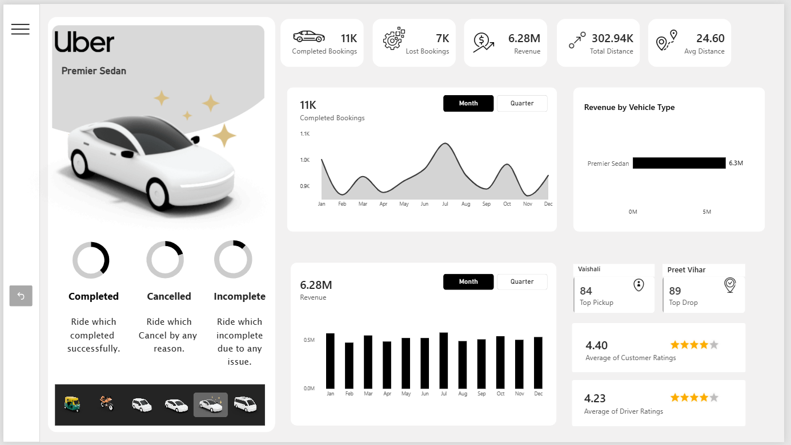

# 🚀 Uber Ride Analytics Dashboard | Power BI Project

## 📌 Project Overview

The **Uber Ride Analytics Dashboard** is an interactive business intelligence project developed using Microsoft Power BI. The dashboard provides insights into ride bookings, revenue performance, booking status, vehicle-wise revenue, trip distance, and customer and driver satisfaction.

The main objective of this project is to transform ride-related data into meaningful visual insights that help understand business performance and identify trends in ride operations.

## 🎯 Project Objectives

- Analyze completed and lost ride bookings.
- Monitor total revenue and ride distance.
- Understand revenue contribution by vehicle type.
- Compare completed, cancelled, and incomplete rides.
- Identify monthly and quarterly performance trends.
- Analyze customer and driver ratings.
- Identify the most frequent pickup and drop locations.

## 📊 Key Performance Indicators (KPIs)

The dashboard tracks the following key metrics:

| KPI | Description |
|---|---|
| Completed Bookings | Total successfully completed rides |
| Lost Bookings | Bookings that did not result in completed rides |
| Total Revenue | Revenue generated from rides |
| Total Distance | Overall distance covered |
| Average Distance | Average distance travelled per ride |
| Customer Ratings | Average customer satisfaction rating |
| Driver Ratings | Average driver performance rating |

## 📈 Dashboard Features

### 1. Booking Analysis
Visualizes completed, cancelled, and incomplete rides to understand booking outcomes.

### 2. Revenue Analysis
Displays total revenue and monthly revenue trends to evaluate financial performance.

### 3. Vehicle-Wise Revenue
Compares revenue generated by different vehicle categories, including Premier Sedan.

### 4. Distance Analysis
Tracks total and average ride distances to understand trip patterns.

### 5. Location Analysis
Highlights top pickup and drop locations to identify frequently used areas.

### 6. Ratings Analysis
Displays average customer and driver ratings to assess service quality.

### 7. Time-Based Analysis
Includes interactive monthly and quarterly views to compare performance over time.

## 🛠️ Tools and Technologies

- **Microsoft Power BI** — Dashboard development and data visualization
- **Power Query** — Data cleaning and transformation
- **DAX** — Measures and KPI calculations
- **Data Modeling** — Organizing data for analysis

## 🖼️ Dashboard Preview

## 💡 Key Insights

The dashboard is designed to help explore:

- Ride completion and cancellation patterns.
- Revenue trends across months and quarters.
- Revenue contribution by vehicle category.
- Differences between pickup and drop location activity.
- Customer and driver satisfaction levels.

Actual business conclusions should be documented after analyzing the underlying dataset and validating the dashboard results.

## 📚 Skills Demonstrated

- Data cleaning and transformation
- Data modeling
- DAX calculations and KPI development
- Interactive dashboard design
- Data visualization
- Business intelligence and data storytelling

## 🚀 Future Improvements

- Add geographic maps for pickup and drop locations.
- Analyze peak booking hours and days.
- Compare revenue and booking performance across vehicle types.
- Introduce additional filters for location and booking status.
- Add year-over-year and quarter-over-quarter comparisons.

## 👨‍💻 Conclusion

This project demonstrates how Microsoft Power BI can be used to transform ride-booking data into an interactive analytics dashboard. It is a practical project for developing skills in data analysis, business intelligence, and dashboard development.

**Tools:** Microsoft Power BI | Power Query | DAX | Data Visualization

---

### 🔖 Tags

`Power-BI` `Data-Analytics` `Uber-Analytics` `Business-Intelligence` `Dashboard` `DAX` `Data-Visualization`
